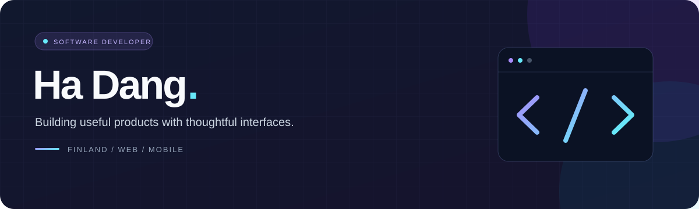
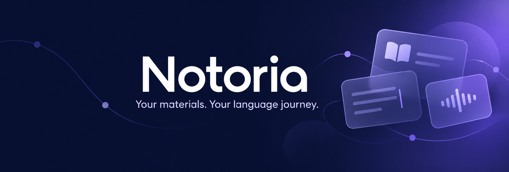
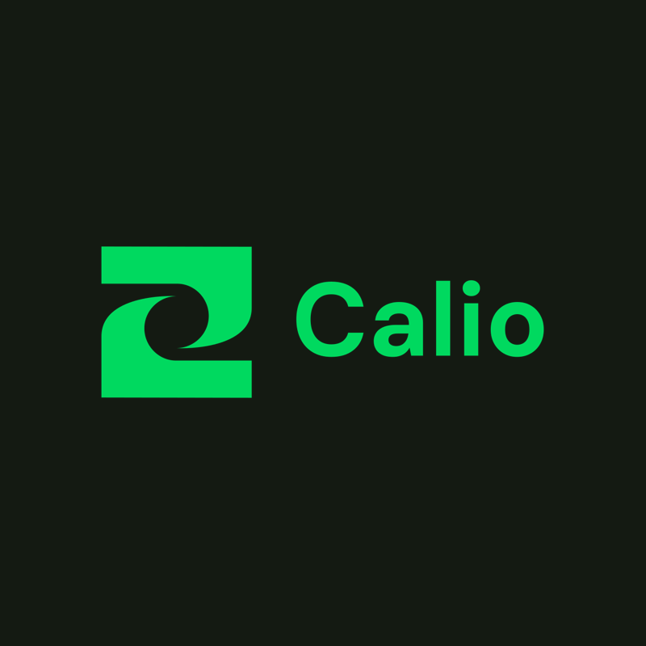

  

<h1 align="center">Ha Dang</h1>

  <strong>Full-stack developer · Founder of <a href="https://www.notoria.fi">Notoria</a> · Helsinki, Finland</strong>

  

  I build products from the interface down to the systems behind it. 
  My work spans SaaS, business tools, and mobile apps, 
  independently and with remote teams across Europe and Vietnam.

  
  &nbsp;
  
  &nbsp;
  
  &nbsp;
  

  
  &nbsp;
  
  &nbsp;
  

---

## Projects

<!-- NOTORIA: full-width showcase, no nested tables -->

  
  

  

  

<h3 align="center">The product I'm proudest of.</h3>

  <strong>Founded, built, and launched end to end.</strong>

  Notoria brings vocabulary, grammar notes, writing, exercises,
  listening, and speaking into private, language-specific workspaces.
  I own the complete product: learning workflows, interface,
  backend, AI integrations, subscriptions, and deployment.

  
  
  

  <strong>100+ worksheets</strong> &nbsp;·&nbsp;
  <strong>100+ listening lessons</strong> &nbsp;·&nbsp;
  <strong>50+ speaking sessions</strong> 
  <strong>First 5 paying subscribers</strong>

  Building Notoria has meant connecting product decisions with engineering:
  helping learning activities work together, protecting private data,
  managing paid access, and handling integration failures.
  Seeing learners use it — and choose to pay for it — makes it special to me.

  
<strong>Explore the engineering behind Notoria</strong>

   

  <ul>
    <li><strong>Learning:</strong> spaced repetition, contextual quizzes, rich-text notes, and writing worksheets.</li>
    <li><strong>AI:</strong> vocabulary assistance, writing feedback, exercise generation, and an activity-based Learning Coach.</li>
    <li><strong>Listening & speaking:</strong> AssemblyAI and OpenAI transcription, plus Stream Video and OpenAI Realtime practice.</li>
    <li><strong>Portability:</strong> CSV/PDF/DOCX import and export, document parsing, field mapping, and validated JSON backup and restore.</li>
    <li><strong>Infrastructure:</strong> workspace permissions, Stripe subscriptions, verified webhooks, and AI usage quotas with refunds on provider failures.</li>
  </ul>

 

  
  
  
  
  
  

  
  &nbsp;
  

  <strong>Follow the journey behind Notoria.</strong> 
  Product updates, new features, and lessons from building it. 
  A follow would mean a lot — thanks for supporting what I'm building 💜

  

 

<!-- CALIO -->

<table width="100%">
  <tr>
    <td>
       
      

        
        
      

      

        
      

      <h3 align="center">Food. Fitness. Progress.</h3>
      

        A mobile app I'm building for meal logging, calorie tracking,
        workouts, goals, and body measurements.
        Calio connects the daily routine: set a goal, log food and activity,
        and follow progress over time.
      

      

        Development currently covers onboarding, authentication,
        and the core food and workout workflows.
      

      

        
        
        
        
        
      

       
      

        
      

       
    </td>
  </tr>
</table>

 

<!-- DOCS EDITOR + CORTEX -->

<table width="100%">
  <tr>
    <td width="50%" valign="top">
       
      

        
      

      <h2>Docs Editor</h2>
      <h3>Write together. Stay in sync.</h3>
      

        A collaborative document editor with rich-text editing,
        live cursors, inline comments, and organization workspaces.
      

      

        Combines TipTap and Liveblocks with Convex-backed document
        management, templates, threaded discussions, and export options.
      

      

        
        
        
        
        
        
      

       
      

        
      

       
    </td>
    <td width="50%" valign="top">
       
      

        
      

      <h2>Cortex</h2>
      <h3>Build in the browser.</h3>
      

        An AI-powered development environment with contextual
        code assistance, project file tools, and real-time synchronization.
      

      

        Connects CodeMirror editing, WebContainer execution,
        GitHub import/export, and background processing with Inngest.
      

      

        
        
        
        
        
        
      

       
      

        
      

       
    </td>
  </tr>
</table>

 

  

## Tech stack

<table width="100%">
  <tr>
    <th align="left">Area</th>
    <th align="left">Technologies</th>
  </tr>
  <tr>
    <td><strong>Languages</strong></td>
    <td>
      
      
      
      
      
    </td>
  </tr>
  <tr>
    <td><strong>Frontend</strong></td>
    <td>
      
      
      
      
      
    </td>
  </tr>
  <tr>
    <td><strong>State & queries</strong></td>
    <td>
      
      
      
    </td>
  </tr>
  <tr>
    <td><strong>Mobile</strong></td>
    <td>
      
      
    </td>
  </tr>
  <tr>
    <td><strong>Backend & APIs</strong></td>
    <td>
      
      
      
      
      
      
    </td>
  </tr>
  <tr>
    <td><strong>Databases & platforms</strong></td>
    <td>
      
      
      
      
      
      
    </td>
  </tr>
  <tr>
    <td><strong>Payments</strong></td>
    <td>
      
      
    </td>
  </tr>
  <tr>
    <td><strong>AI & speech</strong></td>
    <td>
      
      
      
      
    </td>
  </tr>
  <tr>
    <td><strong>Tools & deployment</strong></td>
    <td>
      
      
      
      
      
    </td>
  </tr>
  <tr>
    <td><strong>Monitoring & media</strong></td>
    <td>
      
      
      
    </td>
  </tr>
  <tr>
    <td><strong>Developer tooling</strong></td>
    <td>
      
      
      
    </td>
  </tr>
  <tr>
    <td><strong>Design & creative</strong></td>
    <td>
      
      
      
      
    </td>
  </tr>
    <tr>
    <td><strong>Currently learning</strong></td>
    <td>
      
      
    
      
  </tr>
</table>

## GitHub activity

  <strong>The work behind the projects.</strong>

  
  &nbsp;
  

  
  

<h3 align="center">Contribution timeline</h3>

  <a href="https://github.com/hha297?tab=overview">
    <picture>
      <source media="(prefers-color-scheme: dark)" srcset="https://github-profile-summary-cards.vercel.app/api/cards/profile-details?username=hha297&theme=tokyonight" />
      
    </picture>
  </a>

<h3 align="center">Languages across my work</h3>

  <picture>
    <source media="(prefers-color-scheme: dark)" srcset="https://github-profile-summary-cards.vercel.app/api/cards/repos-per-language?username=hha297&theme=tokyonight" />
    
  </picture>
  <picture>
    <source media="(prefers-color-scheme: dark)" srcset="https://github-profile-summary-cards.vercel.app/api/cards/most-commit-language?username=hha297&theme=tokyonight" />
    
  </picture>

  
<strong>When I commit</strong>

   

  

    <picture>
      <source media="(prefers-color-scheme: dark)" srcset="https://github-profile-summary-cards.vercel.app/api/cards/productive-time?username=hha297&theme=tokyonight&utcOffset=0" />
      
    </picture>
  

  
Time distribution shown in UTC.

  
  &nbsp;
  

---

<h3 align="center">Let's build something useful.</h3>

  Have a product in mind or an opportunity to work together?

  
  &nbsp;
  

  
Elsewhere

   

  

    
    
    
  

  

